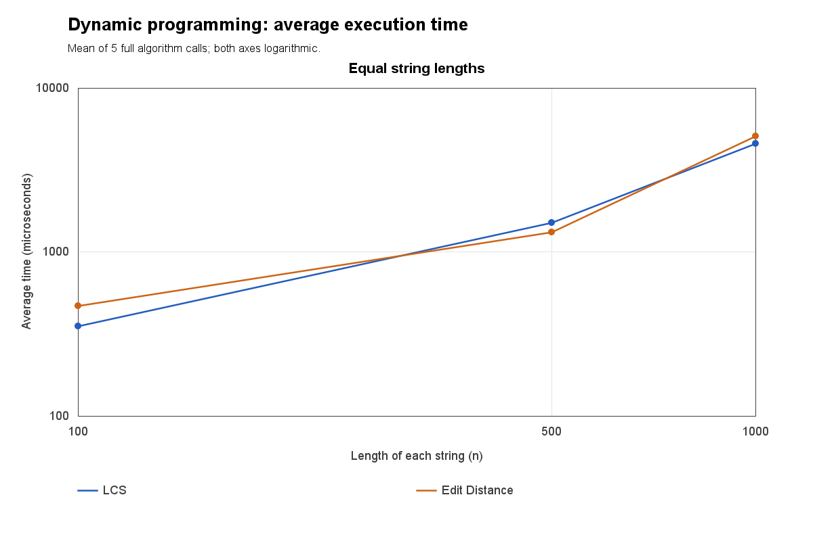
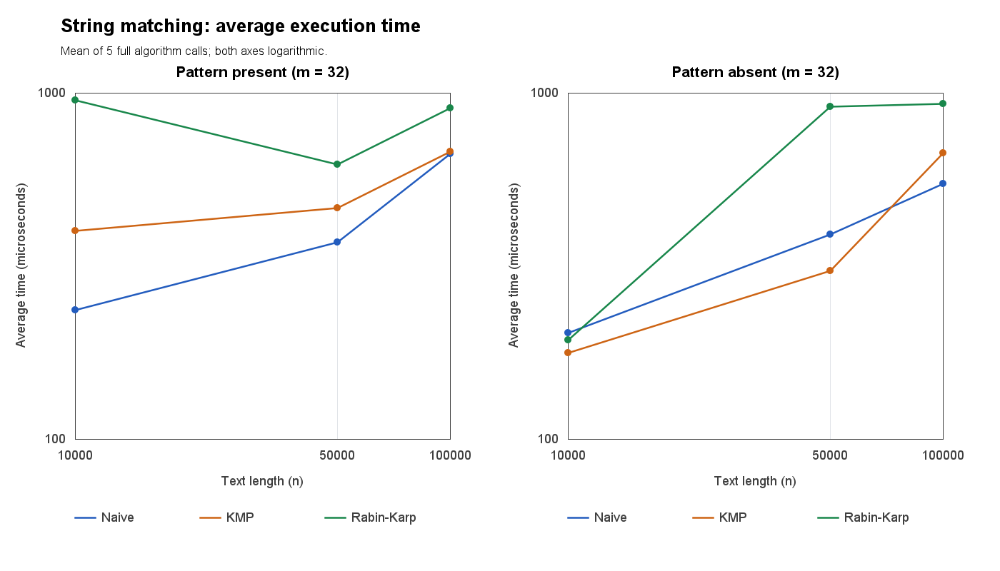

# Assignment 4: Text Analysis

## 1. Overview

Compare strings by LCS subsequence length and Levenshtein edit count; find all occurrences with Naive/KMP/Rabin-Karp; compute adjacent-suffix common-prefix lengths with Kasai. All required algorithms are implemented directly in Java.

## 2. Implementation and Assumptions

DP tables store answers for string prefixes:

- LCS: `L(i,0)=L(0,j)=0`. Equal ends give `L(i-1,j-1)+1`; otherwise `max(L(i-1,j),L(i,j-1))`. Equal ends extend a solution; unequal ends require omitting one end.
- Edit: `D(i,0)=i`, `D(0,j)=j`; `D(i,j)=min(D(i-1,j)+1,D(i,j-1)+1,D(i-1,j-1)+cost)`. Cost is 0 for equal characters, otherwise 1. Minimizing deletion, insertion and substitution covers every possible final operation.

Matching uses case-sensitive UTF-16 units, zero-based indices and overlaps. Empty patterns match boundaries `0..n`; longer patterns have no matches.

KMP's LPS table reuses prefixes without text backtracking. RK uses base 256, modulus 1000000007; verifying every hash hit prevents false matches.

Kasai requires a valid sorted suffix-array permutation. `LCP[0]=0`; `LCP[i]` compares `SA[i-1]` and `SA[i]`. Reusing the previous common length minus one avoids repeated work. Suffix-index sorting prepares inputs outside timing.

## 3. Complexity Analysis

DP lengths: m,n; matching: text n, pattern m, `w=n-m+1`; Kasai: s. Assume nonempty DP inputs and `1<=m<=n`. Space excludes inputs and O(z) returned match indices.

|Algorithm|Main work / justification|Preprocessing|Best / worst core time|Auxiliary space|
|---|---|---|---|---|
|LCS|L recurrence, every cell once|Included|Both Theta(mn)|O(mn)|
|Edit Distance|D recurrence, every cell once|Included|Both Theta(mn)|O(mn)|
|Naive|Compare each alignment; early mismatch or m comparisons|O(1)|Theta(w) / O(wm)|O(1)|
|KMP|LPS fallbacks; text position never decreases|Theta(m)|Both Theta(n)|O(m)|
|Rabin-Karp|Constant-time rolling updates; verify hash hits|Theta(m)|Theta(w) / O(wm)|O(1)|
|Kasai|Rank array and amortized prefix reuse|Included|Both Theta(s)|O(s)|

RK search: `O(w+(z+c)m)` for z matches and c collisions; expected `O(w+zm)` with few collisions, not a worst-case guarantee. Add preprocessing to matching totals. Empty-pattern output takes O(n); longer patterns and empty DP base cases take O(1).

## 4. Testing

15 groups passed, covering every required edge case. Every matching case checks all three algorithms.

References: 250 exhaustive LCS, 150 recursive Edit, 600 `String.indexOf` and 200 adjacent-suffix LCP cases. Actual RK collisions and linear KMP/Kasai counters are tested.

Manual `banana` suffix order: `a, ana, anana, banana, na, nana`; `SA=[5,3,1,0,4,2]`, `LCP=[0,1,3,0,0,2]`.

## 5. Experimental Setup

- Alphabet `abcd`. DP: 100/500/1000; matching: 10000/50000/100000; Kasai: 1000/5000/10000.
- Seed `20261104+n`; add 100000 for matching, 200000 for Kasai. DP shares pairs. Matchers share text/pattern inputs: length 32, present substring or rejection-sampled absent pattern.
- OpenJDK 25.0.1, Windows 11. Five warm-ups/case, five timed calls; `System.nanoTime()` means include preprocessing/allocation/counters, exclude generation/suffix-sorting/verification/I/O.
- Counters: DP updates, preprocessing/search character comparisons, RK initial/rolling hash updates excluding power setup. Kasai comparisons use the search column.

From the project folder, with JDK 17+:

```text
javac --release 17 -d out -sourcepath src src/Main.java
java -cp out Main demo
java -cp out Main test
java -cp out Main experiment
```

IDEA: choose JDK 17+, mark `src` as Sources Root. Experiments regenerate results; timings vary.

## 6. Results

Mean microseconds (`average_ns/1000`): [135 runs](results/tables/runs.csv), [27 summaries/counters](results/tables/summary.csv).

|Each string length|LCS time|Edit Distance time|Cells per algorithm|
|---:|---:|---:|---:|
|100|353.260|468.360|10000|
|500|1513.260|1320.520|250000|
|1000|4609.960|5110.140|1000000|

|Text length|Pattern|Naive|KMP|Rabin-Karp|
|---:|---|---:|---:|---:|
|10000|Present|235.720|399.820|952.280|
|10000|Absent|203.100|177.380|193.400|
|50000|Present|370.620|465.200|620.720|
|50000|Absent|389.860|307.320|913.520|
|100000|Present|667.120|676.580|905.360|
|100000|Absent|546.420|670.200|930.380|

|Kasai length|Time|Character comparisons|
|---:|---:|---:|
|1000|173.860|1990|
|5000|239.900|9990|
|10000|265.580|19989|





## 7. Discussion

DP updates grow quadratically; Kasai comparisons grow linearly. Random mismatches let Naive stop early. At n=100000, present-pattern search comparisons were 133028/124988/32 for Naive/KMP/RK; RK also needed 100032 hash updates. Hash arithmetic explains why fewer comparisons did not mean faster execution. Fixed m=32 does not demonstrate worst-case growth. JVM/allocation/scheduling cause fluctuations; three sizes cannot prove Big-O.

## 8. Conclusion

DP trades quadratic storage for reusable subproblems. Naive is simple, KMP guarantees linear matching, RK adds hashing costs, and Kasai builds LCP linearly from a suffix array.
